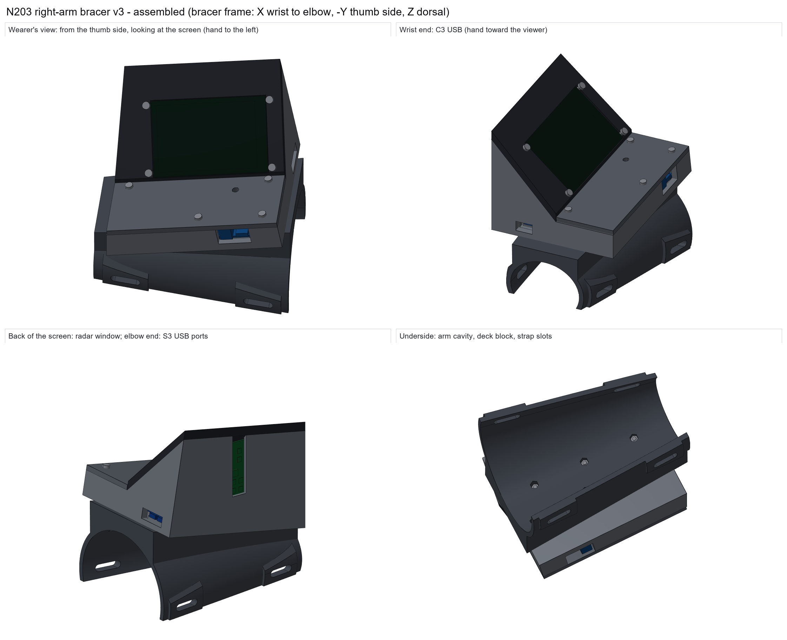
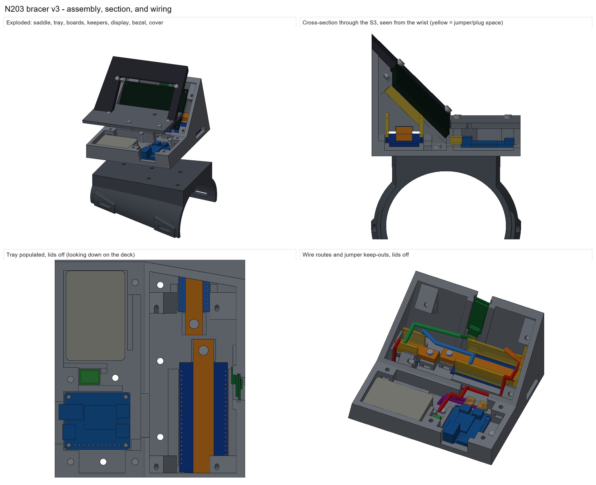
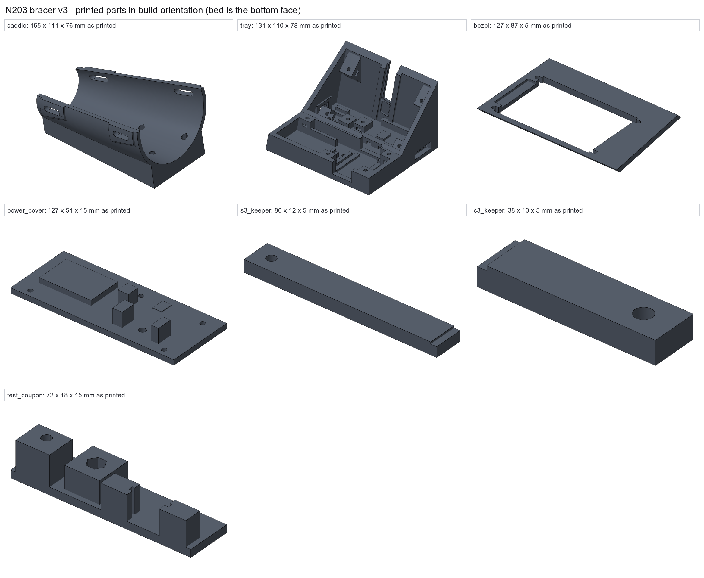

# N203 right-arm bracer, version 3 (for a loosely tuned printer)

A printable forearm mount for the N203 tracker: an arm brace, one electronics
tray, a display bezel, a power cover, and two board keepers. Version 2 had the
same layout but mostly failed when printed in PLA on an Ender 3 Pro with a
0.4 mm nozzle; this version is redrawn for that kind of printer. Nothing here
has been printed yet. Print the test coupon first.

The STEP and STL files are generated, not stored in the repository; see
[Generating the files](#generating-the-files). The images show the reference
arm.





Layout: screen landscape along the
forearm, tilted 45 degrees toward the thumb side, header toward the elbow;
radar in the back wall behind the screen, looking straight out, long axis
upright.

## What failed in version 2, and what changed

| Reported on the print | Cause in the version 2 model | Version 3 |
| --- | --- | --- |
| Tray walls too thin, snapped when a board went in | 3 mm walls and floor; board slots with 0.25 to 0.3 mm clearance, which a loose printer turns into a press fit | 5 mm walls, 4 mm floor. 0.5 to 0.6 mm clearance around every board. |
| Small outcrops fell off the bed or when a board touched them | Posts, pegs, tabs, and bosses with 2 to 40 mm^2 footprints | No free-standing feature under 50 mm^2. Guides are rails, bosses are blocks that grow out of a wall. |
| Some pieces dangling by a string | The display supports were drawn so their lowest edge hung below where they joined the wall, so they started printing in mid-air. This was a modelling error, and the version 2 checks did not look for it. | Upper supports are gussets that rest on the back wall all the way up; lower ones leave the divider and rise away from it. A new check finds any feature that starts in mid-air. |
| Mount holes in the brace "aren't really holes" | 2.8 mm self-tapping pilot holes, blind, starting on the bed face | No self-tapped holes anywhere. Every bolt passes through 3.8 mm clearance holes into a steel M3 nut. Bed-face holes have a lead-in. |
| Covers and thin parts flimsy | 2.5 mm cover, 4 mm bezel, 3 mm keepers | 4 mm cover, 5 mm bezel, 5 mm keepers. |
| Brace mostly fine | | Shell 3 to 4 mm, because strap tension bends it across the layer lines. Deck 3 mm thicker so the nuts sit clear of the arm. |

One thing the model does not explain: the version 2 cover and bezel files are
2.5 mm and 4 mm thick (12 to 20 layers at 0.2 mm) and the meshes are sound, so
"essentially one layer" with strands that pull apart did not come from the
drawing. Strands that do not fuse to their neighbours, and layers that peel,
usually mean too little plastic or a first layer laid too high. Thicker parts
will tolerate that better but will not cure it. See the settings below.

## Print the test coupon first

`n203_v3_test_coupon.stl`, in the generated `print/` folder, is
72 x 18 x 15 mm. It carries the
three fits everything else depends on:

1. **Block with a side slot** (left). An M3 nut should slide into the slot and
   not turn; an M3 bolt should drop through the hole and thread into it.
2. **Hexagonal pocket** (middle). A nut should drop in from the top; a bolt
   pushed up from the bed face should thread into it.
3. **Radar slot** (right). The RD-03D should slide down between the jaws with
   light finger pressure, gold antenna face toward the thin lip.

If a bolt hole is tight, run a 3.5 mm drill through it or twist the bolt
through; that is expected on some printers and does no harm. If a nut or the
radar board will not go in, or the blocks snap off the base by hand, stop:
the big parts will fail the same way. Note which fit was off and by roughly
how much, adjust the matching constant in `v3_geometry.py` (`NUT_SLOT_W`,
`NUT_POCKET_AF`, or `RADAR_SLOT_FIT`), and regenerate.

## Print settings

For an Ender 3 Pro, 0.4 mm nozzle, PLA. These are ordinary values chosen for
strength rather than speed.

| Setting | Value |
| --- | --- |
| Layer height | 0.2 mm |
| Walls (perimeters) | 4 |
| Top and bottom layers | 5 |
| Infill | 25 % |
| Nozzle temperature | 210 to 215 C (the hot end of the PLA range bonds layers better) |
| Bed | 60 C |
| Speed | 40 to 50 mm/s, first layer 20 mm/s |
| Supports | none |
| Brim | 5 to 8 mm on the saddle and the tray |

Before the long prints, look at one first layer. The lines should be pressed
into each other so the layer is a continuous sheet. If you can pick individual
lines apart, the nozzle is too high above the bed or the printer is feeding too
little plastic. On this printer the usual suspects are bed levelling, a cracked
plastic extruder arm, a gap where the Bowden tube meets the nozzle, and damp
filament.

## Parts

The generator writes these to `models/print/` (`models/local/print/` when you
use your own arm measurements), already turned to their build orientation with
the bed face on Z = 0, as STEP and STL.

| Part | Build size (mm) | Bed face | Notes |
| --- | --- | --- | --- |
| `n203_v3_test_coupon` | 72 x 18 x 15 | base | Print this first. |
| `n203_v3_saddle` | 155 x 111 x 76 on the reference arm | mounting deck | Arm cavity opens upward. Strap-slot roofs are 20 mm bridges. Use a brim. |
| `n203_v3_tray` | 131 x 110 x 78 | floor | Longest bridge is 25 mm, over the S3 USB opening. Use a brim. |
| `n203_v3_bezel` | 127 x 87 x 5 | front face | |
| `n203_v3_power_cover` | 127 x 51 x 15 | outer face | Pad and pillars point up. |
| `n203_v3_s3_keeper` | 80 x 12 x 5 | flat top | Stepped tongue points up. |
| `n203_v3_c3_keeper` | 38 x 10 x 5 | flat top | Stepped tongue points up. |

Everything fits a 220 x 220 mm bed. The saddle and the tray are long prints.

## Arm fit

The brace is lofted through the width and height of a forearm at three
stations, plus 2 mm of allowance per side. By default that is a nominal
reference arm: 58 x 44 mm at the wrist end, 80 x 72 mm at 85 mm, and
95 x 86 mm at 145 mm. It will not fit every arm.

To fit yours, measure the width and height of your forearm at the same three
distances from where the wrist end of the brace will sit. Copy
`../arm_fit.example.json` to `../arm_fit.local.json`, put your numbers in it,
and run the generator. The deck width, nut pockets, and all the checks follow
the arm. That file is ignored by git, and while it exists the output goes to
`models/local/` so the images in this README keep showing the reference arm.
Add `--reference-arm` to ignore it for one run.

## Hardware

| Qty | Item | Used for |
| ---: | --- | --- |
| 11 | M3 x 12 pan-head machine screw | tray to saddle (5), power cover (4), keepers (2) |
| 4 | M3 x 14 pan-head machine screw | bezel and display |
| 15 | M3 hex nut, standard 5.5 mm across flats | one per bolt |
| up to 11 | M3 washer, optional | under the M3 x 12 heads only |
| 2 | 20 mm hook-and-loop cinch strap | arm straps |
| 1 | ~2 mm soft foam strip | cover pad over the battery; optional under the cover pillars |
| 3 | small zip tie | tunnels in the rail beside the ESP32-S3 |
| ~20 | female-female jumper, 15-20 cm | signal and power wiring |
| | adhesive tape | holds nuts in place until their bolts catch |

The four display bolts must be 14 mm and go in without washers: at that length
the bolt ends flush with the far face of its nut. The M2.5 charger screws are
gone; the charger is held by the cover.

## Assembly order

1. **Holes.** A bolt should drop through every hole. Open any tight one with a
   3.5 mm drill or by twisting the bolt through.
2. **Nuts into the saddle.** Lay the saddle with the arm cavity up, drop a nut
   into each of the five hexagonal pockets, and tape over them.
3. **Tray to saddle.** Five M3 x 12 from inside the tray: three in a row down
   the wiring lane of the logic bay and two in the power bay.
4. **Nuts into the tray.** Ten side slots, each beside its bolt hole:
   - four display supports, slots opening toward the middle of the screen;
   - four blocks in the power bay, slots opening into the bay (the battery and
     the regulator later sit in front of two of them);
   - two keeper blocks at the ends of the MCU boards, slots opening toward the
     divider.
   A scrap of tape over a slot keeps its nut in until the bolt catches.
5. **Radar.** Plug in its lead, then slide the board down the slot in the back
   wall: gold antenna face outward, connector end at the bottom.
6. **ESP32-S3.** Component side down, pins up, USB end toward the elbow-end
   wall. Bring it in tilted with the USB end low, seat that end in the wall
   opening, lay the board flat between its two rails. Slide the keeper bar's
   tongue into the wall pocket above the USB ports and fix the other end with
   one M3 x 12.
7. **ESP32-C3.** Same way, USB end toward the wrist-end wall. Hook the keeper's
   tongue under the shelf on that wall and fix it with one M3 x 12.
8. **Power bay.** Battery against the wrist end. Regulator in the pocket behind
   the battery's end wall. Charger on its two rails with the USB-C and barrel
   jack in the wall notch; the two JST plugs reach through the divider notch.
9. **Wire it** using the table below. Zip-tie bundles to the rail beside the
   S3, which has three tunnels through it.
10. **Display.** Plug jumpers onto the rear header, lay the display on its four
    supports with the header toward the elbow, set the bezel over it, and drive
    four M3 x 14 through bezel and display into the nuts.
11. **Power cover.** Foam strip on the pad, then four M3 x 12. The hole shows
    the charger's status LEDs.
12. **Straps** through the four slots.

Tighten until snug. The nuts take the load, so there is nothing to strip, but
PLA will crush if a bolt is forced.

## Wiring

Space for wiring is designed in and checked: every header
position has room for a 14 mm jumper housing, every plug has room, and the
CAD assembly has a `wiring_guides_hide_or_delete` group showing connector
spaces (yellow) and suggested bundle paths (coloured tubes).

Connections, using the silkscreen labels. They come from
`hardware/display/ili9488-xpt2046.md` and `hardware/scanner-link/`.

| From | To | Note |
| --- | --- | --- |
| Display `CS` | S3 `GPIO10` | |
| Display `RESET` | S3 `GPIO14` | |
| Display `DC/RS` | S3 `GPIO9` | |
| Display `SDI(MOSI)` and `T_DIN` | S3 `GPIO11` | two display pins on one S3 pin: needs a Y-splice |
| Display `SCK` and `T_CLK` | S3 `GPIO12` | second Y-splice |
| Display `LED` | S3 `GPIO6` | |
| Display `T_DO` | S3 `GPIO13` | |
| Display `T_CS` | S3 `GPIO8` | |
| Display `T_IRQ` | S3 `GPIO7` | |
| Display `SDO(MISO)` | not connected | |
| C3 `GPIO21` (TX) | S3 `GPIO41` (RX) | |
| C3 `GPIO20` (RX) | S3 `GPIO42` (TX) | |
| Radar `TX` | C3 `GPIO4` | optional 47-100 ohm in series |
| Radar `RX` | not connected | read-only v1 |
| Battery | Charger `BATT` JST | |
| Charger `LOAD` JST | Regulator `VIN`, `GND` | |
| Regulator `VOUT` (5 V) | S3 `5V`, C3 `5V`, display `VCC`, radar `5V` | one splice just inside the logic bay |
| Regulator `GND` | S3, C3, display, radar `GND` | common ground |

With the display installed, `VCC` is the lowest header pin and `T_IRQ` the
highest. On the DevKitC-1 pinout that the S3 clone follows, all nine display
signals and the `5V`/`GND` pair are on the header row next to the back wall;
`GPIO41`/`GPIO42` are on the other row. Go by the silkscreen if your board
differs.

Electrical cautions, unchanged and not settled by this mechanical design:

- `docs/v1-software-status.md` still lists the shared 5 V arrangement as
  unverified. Confirm it on the bench before closing the case.
- Many ESP32-C3 SuperMini boards tie their `5V` pin straight to USB VBUS. If
  yours does, plugging USB into the C3 while the battery rail is live joins two
  5 V sources. Check your board, or unplug the regulator output first.
- There is no power switch. Powering down means opening the cover and
  unplugging the battery.

## Check these before the long prints

The board models are approximate. These assumptions shape the tray:

1. **Header pins point away from the components** on both MCU boards, so the
   boards mount upside down with the pins facing the opening.
2. **Radar connector end goes down**, antenna face out. Run the
   position-verify build before closing up.
3. **USB socket positions.** The S3 opening is 25 mm wide and the C3 opening
   15 mm wide.
4. **Board outlines**: S3 63.5 x 27.94 mm, C3 22 x 18 mm, charger
   38.1 x 33.02 mm. Each pocket is about 1 mm larger. Measure yours.
5. **microSD socket** on the back of the display. The model has it reaching to
   3.5 mm from the mounting hole nearest the wrist on the lower edge, so that
   support is cut short. If your display differs there, change
   `DISPLAY_SD_ENVELOPE` in `v3_geometry.py`.

## Known limits

- **Bulk.** The tray is 131 x 110 x 78 mm and, on the reference arm, the
  assembly is 145 x 111 x 152 mm. The back wall stands roughly 90 mm above
  the forearm.
- **Nuts on the arm side.** The five saddle nuts sit in pockets inside the arm
  cavity, at least 1 mm below its surface, behind the 2 mm fit allowance. Tape
  over them or add a liner if you feel them.
- **Fewer tie-down points**: three, all on the S3 rail.
- **BOOT and RESET buttons face the floor**, the S3 ports face the elbow and
  the C3 port faces the hand, and bending the hand back is limited.
- **MPU-6050** is not placed.

## Coordinate frames

- **Bracer frame**, used by the assembly: X from wrist to elbow, Z away from
  the back of the forearm, Y completing the right-handed set. On a right arm
  held palm-down the thumb side is -Y.
- **Tray frame**: the deck is tilted 10 degrees so the tray follows the top of
  the forearm. The tray is modelled and printed in this frame.

## Generating the files

Set up the CadQuery environment first (see `../README.md`). Then, from the
repository root:

```powershell
.\build\cadquery-venv\Scripts\python.exe hardware\mechanical\generate_component_models.py
.\build\cadquery-venv\Scripts\python.exe hardware\mechanical\bracer_v3\generate_bracer_v3.py
.\build\cadquery-venv\Scripts\python.exe hardware\mechanical\bracer_v3\render_bracer_v3_preview.py
```

The first command builds the board models the design is checked against, the
second writes the printable STEP and STL files and the CAD assembly, and the
third redraws the preview images.

`generate_bracer_v3.py` runs 207 checks and exits with an error if any fail:

| Group | What it proves |
| --- | --- |
| printable | each part is one valid solid, fits the bed, and needs no supports |
| robust | no wall thinner than 2.4 mm, no free-standing cross-section under 50 mm^2, nothing that starts printing in mid-air |
| interference | no two bodies overlap |
| fasteners | every bolt and nut sits in a clear hole, slot, or pocket; each nut can be slid in, is trapped once in, and cannot spin |
| captive | every board and printed part is stopped in all six directions |
| wiring | jumper, plug, and USB spaces are empty; wire routes are unobstructed |
| assembly | each board and keeper has a collision-free path into its seat |
| saddle | strap slots are open, nut pockets keep nuts and bolt tips off the arm |
| function | screen visible, landscape, facing the thumb side, header on the right; radar unobstructed and looking out the back; every tray bolt reachable |

The `robust` group was added after the version 2 print. Run against the
version 2 parts as a control during development, it flagged that tray for 34
thin-wall patches (thinnest 0.6 mm), 2 display supports that started in
mid-air, and 120 undersized free-standing slices, which matches what the
print did. It cannot predict how a particular printer behaves; the test coupon
does that.

Results are written to `n203_v3_manifest.json` beside the assembly. Add
`--checks-only` to
run the checks without exporting. All dimensions are constants at the top of
`v3_geometry.py`.
